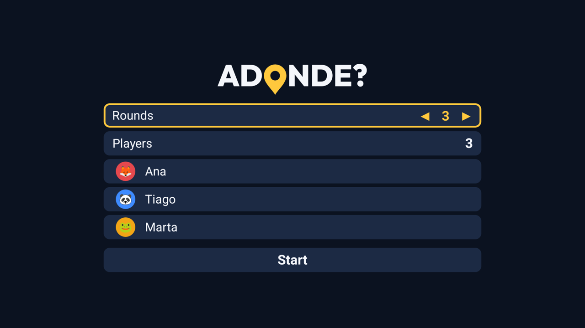
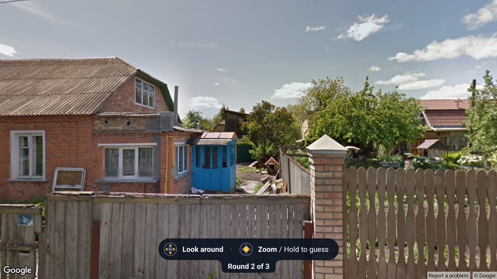
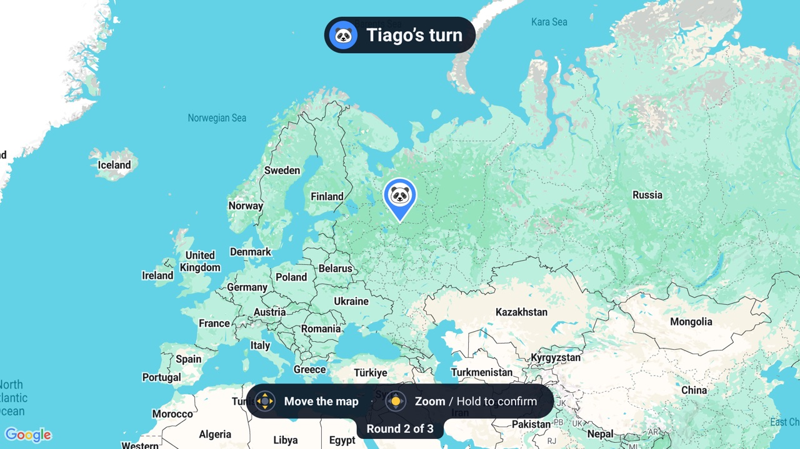
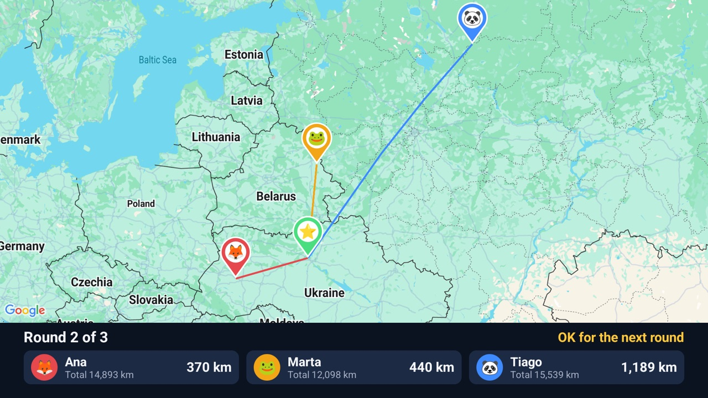
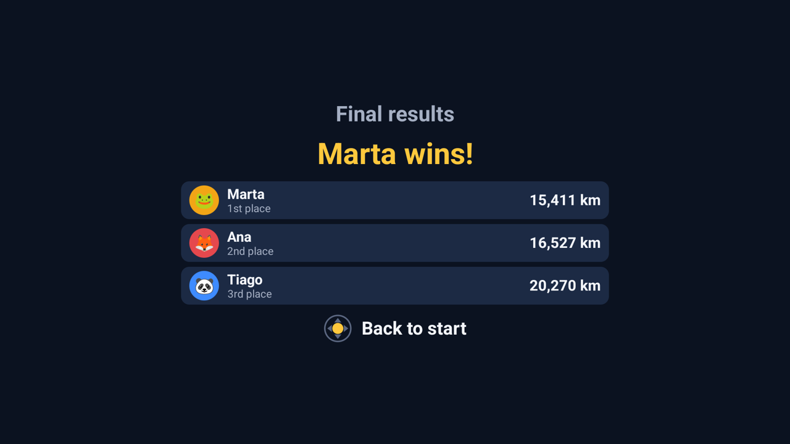
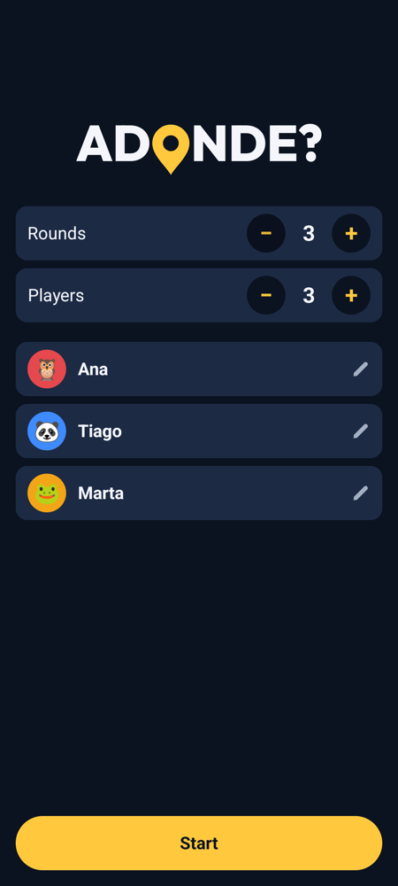
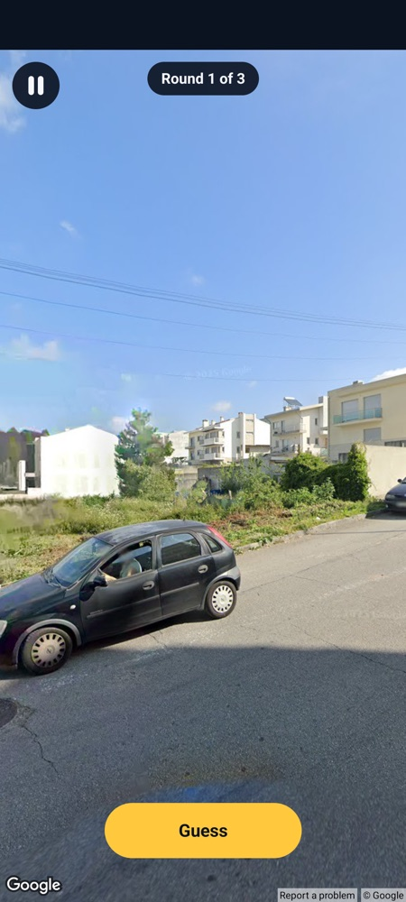
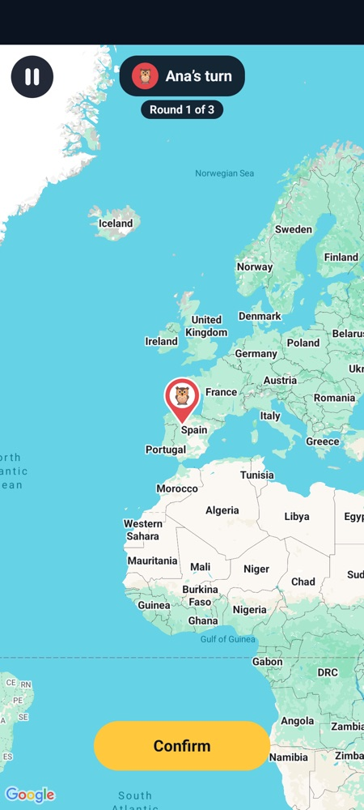
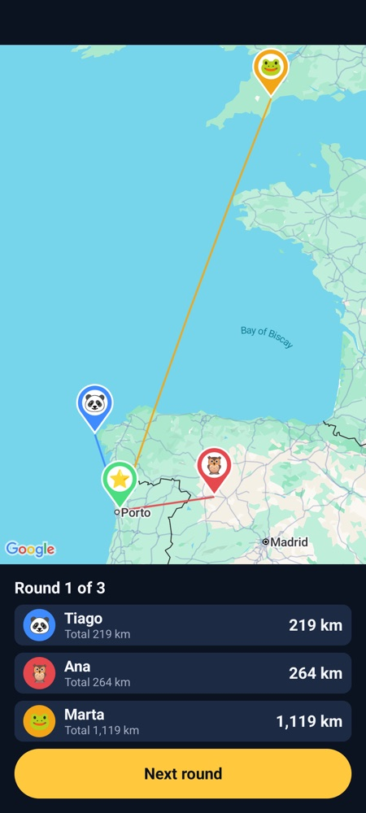
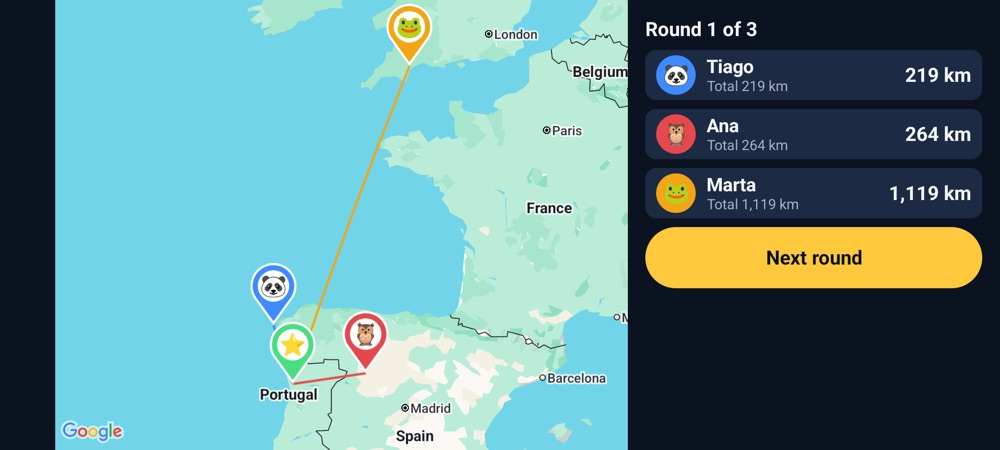

# Adonde


**Where in the world are we?** Adonde drops you somewhere on Earth in Google Street View. Everyone looks around
together, then each player puts a pin on the map where they think it is. The closer the pin, the better.

It's a family game for the living-room TV, played with the remote by 1 to 6 people. There's also a version for
phones and tablets, on Android and on iPhone and iPad, passed from hand to hand. Inspired by GeoGuessr. It's for
personal use: sideloaded, not on Google Play or the App Store.

- [How to play](#how-to-play)
- [On the TV](#on-the-tv)
- [On a phone or tablet](#on-a-phone-or-tablet)
  - [Android](#android)
  - [iPhone and iPad](#iphone-and-ipad)
- [Google Maps keys](#google-maps-keys)
- [For developers](#for-developers)
- [License](#license)

## How to play

1. **Set up the game.** Choose how many rounds (1 to 10) and players (1 to 6), and give everyone a name and an
   animal.
2. **Look around.** A random Street View place fills the screen. There's no time limit: look for signs, cars,
   plants, the side of the road people drive on, anything that gives the place away.
3. **Guess.** When everyone is ready, each player in turn moves the map under the pin and confirms. A different
   player goes first each round.
4. **See the answer.** The real place appears on the map with everyone's pins, how far off each one was, and the
   running totals.

After the last round comes the final ranking. **The fewest kilometres in total wins.**

### Records

Each device keeps the family's records: the five closest guesses ever, and how many games and rounds under 100 km
each player has won. Only players with a name of their own get records, so a name is how the game knows who's who.
A yellow **New record** tag marks the closest guess ever when the answer is shown, the final ranking lists the
records the game broke, and **Records**, next to Start, shows them all.

## On the TV

The TV version runs on Google TV and Android TV (Android 8 or later).

### Playing with the remote

| Set up | Look around |
|---|---|
|  |  |
| **Guess** | **The answer** |
|  |  |

Everything is done with the remote's arrows, OK and Back. The bar at the bottom of the screen always shows what
the buttons do.

| | Arrows | OK | Hold OK |
|---|---|---|---|
| **Setup** | Up and down pick a row; left and right change the number or the animal | Changes a player's name, or starts | |
| **Looking around** | Turn the view | Switches between turning and zooming | Moves on to the guesses |
| **Guessing** | Move the map | Switches between moving and zooming | Confirms the guess |
| **The answer** | | Next round, or the final results | |

When zooming, up and down zoom in and out, while left and right still turn the view or move the map. The bar
gets a yellow outline so you know.

**Back** pauses the game. Pressing Back again on the pause screen leaves the game.



### Installing on the TV

You need [Android Studio](https://developer.android.com/studio) (for its Java and the Android SDK) and an
[Android Maps key](#google-maps-keys) in `local.properties`.

Turn on debugging in the TV's Developer options, connect it with `adb connect <the TV's address>:5555`, then:

```bash
export JAVA_HOME="/Applications/Android Studio.app/Contents/jbr/Contents/Home"
./gradlew testDebugUnitTest installRelease
```

That runs the tests and installs the TV version. With several devices connected, choose one with
`ANDROID_SERIAL=<device>` in front of the command.

**Use the release build.** On the TV it starts about four times faster than the debug build. Both are signed with
the debug key, so either installs over the other and the Maps key works with both.

## On a phone or tablet

The phone and tablet version plays the same rounds by touch, with the device passed from player to player. It
looks and plays the same on Android and on iPhone and iPad.

### Playing by touch

| Set up | Look around | Guess | The answer |
|---|---|---|---|
|  |  |  |  |

- **Set up:** − and + change the rounds and players. Tap an animal for the next free one, and tap a name to
  change it.
- **Look around:** drag to turn and pinch to zoom, then tap **Guess**.
- **Guess:** drag and pinch the map under the pin, then tap **Confirm**.
- **Pause:** the button at the top left, or Back. **Quit** leaves the game, so a stray swipe can't end it.

It works in portrait and landscape, and turning the device doesn't reload the place. On a phone on its side, the
setup and the scoreboard go side by side:



### Android

Android phones and tablets need Android 12 or later. Set up Android Studio and the
[Android Maps key](#google-maps-keys) as for the TV, connect the phone over wireless debugging (in Developer
options; its port changes, and `adb devices` shows the current one), then:

```bash
export JAVA_HOME="/Applications/Android Studio.app/Contents/jbr/Contents/Home"
./gradlew :mobile:installRelease
```

**The TV and phone versions share one package name**, so one key covers both, but installing one over the other
replaces it. That's why the phone version only installs when it's named with `:mobile:`, as above.

### iPhone and iPad

The `ios/` folder holds the game for iPhone and iPad (iOS 17 or later), written in SwiftUI. On iPad it turns every
way and can share the screen with other apps.

You need a Mac with Xcode, and an [iOS Maps key](#google-maps-keys):

1. Copy `ios/Config/Secrets.example.xcconfig` to `ios/Config/Secrets.xcconfig` and put the key in it. Git
   ignores that file.
2. Open `ios/Adonde.xcodeproj` in Xcode and run it on a simulator. `AGENTS.md` has the command-line version.

To run it on your own iPhone or iPad:

1. Add your Apple ID in Xcode (Settings → Accounts), and pick its team once under the project's Signing &
   Capabilities.
2. Put the team's id in `Secrets.xcconfig` as `DEVELOPMENT_TEAM`, so it stays out of git.
3. Plug the device in, trust the computer, and turn on Developer Mode (Settings → Privacy & Security).
4. Run it. With a free Apple ID, trust the developer the first time on the device, in Settings → General → VPN &
   Device Management. Apps signed this way stop opening after 7 days, until they're installed again.

## Google Maps keys

Each new place costs a little of Google's free Street View allowance; see
[Google Maps limits](#google-maps-limits).

**For Android (the TV and Android phones):**

1. In the [Google Cloud console](https://console.cloud.google.com/), create a project and turn on billing.
2. Enable the **Maps SDK for Android**.
3. Create an API key and restrict it to Android apps, with the package `com.jjmluz.adonde` and the SHA-1 of your
   debug signing key.
4. Under Quotas, put a cap on Dynamic Street View, so a bug can't run up a bill.

Then create `local.properties` at the top of the project. Git ignores it, so the key stays private:

Create `local.properties` at the top of the project. Git ignores it, so the key stays private:

```properties
sdk.dir=/path/to/Android/sdk
MAPS_API_KEY=your_key
```

**For iPhone and iPad:** in the same Cloud project, enable the **Maps SDK for iOS** and create a second key,
restricted to iOS apps with the bundle id `com.jjmluz.adonde`. It goes in `ios/Config/Secrets.xcconfig`, as
described under [iPhone and iPad](#iphone-and-ipad). Put a quota cap on it too.

## For developers

### How the code is organised

Four Gradle modules:

- `core`: the rules, in Kotlin Multiplatform so the iOS app uses them too. Tested in `GameTest.kt`.
  - `Game.kt`: players, rounds, turn order, distances.
  - `Places.kt`: picks where to look for a panorama.
  - `Records.kt`: the records, and which ones a game broke.
- `shared`: what both Android apps use: the text in every language, the places, the globe and the logo font.
  - `GameViewModel.kt`: the game's state and flow.
  - `Maps.kt`: the Street View panorama and the Google maps.
  - `Theme.kt`: the colours, the logo, avatars and scoreboard rows.
  - `RecordViews.kt`: the records' cards and rows.
- `app`: the TV version.
  - `TvViewModel.kt`: what the remote's keys do.
  - `Controls.kt`: turning the panorama and moving the map with the D-pad.
  - `Screens.kt`: the TV's screens.
- `mobile`: the phone and tablet version. `Screens.kt` has its screens; the panorama and the map take touch
  gestures themselves.

Outside Gradle, `ios/` is the Xcode project for iPhone and iPad. Its text comes from the Android text through
`tools/build_ios_strings.py`.

### Adding a language

The text is in `shared/src/main/res/values*/strings.xml`, with English in `values/`. Copy that file to
`values-xx/`, translate it, add the code to `localeFilters` in `app/build.gradle.kts` and
`mobile/build.gradle.kts`, and run `python3 -I tools/build_ios_strings.py` for iOS.

### Testing on an emulator

A Google TV emulator is fine for the TV version's layout, and any phone emulator with Google Play for the phone
version. Every round loads a panorama, which counts towards the Street View allowance.

`adb shell input keyevent` is too quick to count as holding a key. This holds OK for 1.6 seconds (the second key
is only there because the command needs two):

```bash
adb shell input keycombination -t 1600 KEYCODE_DPAD_CENTER KEYCODE_F12
```

If the emulator only ever shows the "no place found" screen, it has resumed from a stale snapshot: its clock is
days behind and hostname lookups hang. Cold-boot it with `emulator -avd <name> -no-snapshot`.

### Google Maps limits

- **Cost:** with an EEA billing address, Google doesn't allow the Static or Tile Street View APIs on or next to a
  map. The panorama in the Maps SDK is what it recommends instead, and it's billed as Dynamic Street View: 5,000
  free a month, then $14 per 1,000. Maps are free.
- **People's own photos:** these turn up even with the outdoor filter, and their credit can name the place, so
  they're skipped by the length of their panorama id. Searches start close to towns, with a small radius, to land
  on Google's own roads: about 3 in 4 do.
- **Zooming out:** on Google TV the SDK only has its older renderer, which never zooms out past about 168° of
  longitude. The whole world can't fit on screen at once, so the answer screen centres on the answer when the
  pins don't all fit. Phones have the newer renderer, but they do the same when far-apart pins don't fit.
- **Google's notices** (its logo, the copyright and Street View's "Report a problem") are required and always stay
  on screen.

### Data and credits

- `shared/src/main/assets/places.csv`, the towns the game starts searching from, is built by
  `tools/build_places.py` from [GeoNames](https://www.geonames.org/)' `cities15000` file (CC BY 4.0), keeping
  countries with wide Street View coverage.
- `shared/src/main/assets/globe.csv`, the dots of the spinning globe, is built by `tools/build_globe.py` from
  `land-110m.json` in the [world-atlas](https://github.com/topojson/world-atlas) package, which is
  [Natural Earth](https://www.naturalearthdata.com/)'s public-domain land data.
- `tools/make_art.swift` draws the TV's launcher banner and icon, and the iOS icon. The Android phone's icon is
  the pin in `mobile/src/main/res/drawable/ic_launcher_pin.xml`.
- The logo is set in [Outfit](https://github.com/google/fonts/tree/main/ofl/outfit), under the SIL Open Font
  License 1.1.
- The screenshots in `docs/screenshots` were taken on the Android emulators. Street View imagery © Google.

## License

Adonde's code is under the [MIT License](LICENSE). The Outfit font, the GeoNames and Natural Earth data and the
Street View imagery keep their own licenses, listed under [Data and credits](#data-and-credits).
